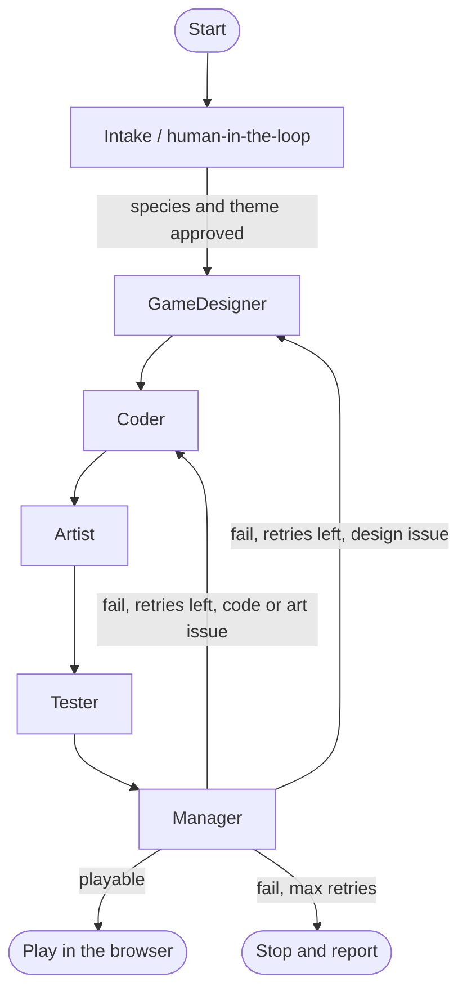

# pet-game-agents-web

A web app version of the pet-game-agents crew: a **Node.js / Express** backend and a simple vanilla JavaScript frontend that together design, build, and let you play a pet-raising game (*game nuôi thú*).

*Tóm tắt: phiên bản web của khung đa tác nhân — các agent thiết kế, lập trình, vẽ và kiểm thử một game nuôi thú, bạn theo dõi tiến trình và chơi ngay trên trình duyệt.*

This is a **separate project** from the Python repository. The orchestration is the same: a Manager coordinates GameDesigner, Coder, Artist, and Tester on a graph (`intake → design → code → art → test`) with conditional retry edges. Agents invent the gameplay. You are only asked about **major decisions** (species and theme), unless auto-approve is on.

Mock mode is the default when no API key is set. LLM mode is optional via `OPENAI_API_KEY`. No real keys are stored here — only `.env.example`.

## Architecture



The backend runs the graph and streams each agent step to the browser with **Server-Sent Events**. If the intake node interrupts, a form appears so you can answer in the UI. When the Tester passes, the generated Little Companion game (feed / play / sleep, stat bars, leveling, SVG moods) is playable on the same page.

The game engine itself is a JavaScript port of the offline Little Companion / Mochi logic and lives in `src/game.js` (also served to the browser as `/js/game.js`).

## Setup

Node.js 18+ is required.

```bash
npm install
npm start
```

The server listens on port **3100** by default (`PORT` can override this). Open http://127.0.0.1:3100/

### Mock mode (offline)

Use the form on the homepage, or call the API:

```bash
curl -s -X POST http://127.0.0.1:3100/api/runs \
  -H 'Content-Type: application/json' \
  -d '{"species":"cat","theme":"cozy backyard companion","autoApprove":true,"mode":"mock"}'
```

Subscribe to progress: `GET /api/runs/:id/events` (SSE). If you left auto-approve off, answer with `POST /api/runs/:id/decision`.

### LLM mode

```bash
cp .env.example .env
# set OPENAI_API_KEY, optional OPENAI_BASE_URL and OPENAI_MODEL
```

`LLM_MODE=auto` (the default) uses an LLM when a key is present, otherwise mock mode.

## How to play

After a successful run, the Play panel loads the pet:

- **Feed**, **Play**, **Sleep**, or **Wait**
- Hunger is a fullness meter (100 is well fed, 0 is starving)
- Every action advances a turn and applies a little decay
- Reach level 5 without letting a stat hit zero

## Tests

```bash
npm test
```

The suite covers game mechanics, the graph (end-to-end mock run, retry, interrupt/resume, give-up), and the human decision helper.

## Layout

```
src/                 Graph, agents, game engine, Express server
public/              Static UI (HTML, CSS, app.js)
tests/               node:test suite
output/              Written by a pipeline run (and optional screenshots)
```

## License

MIT. See [LICENSE](LICENSE).
